  

  
  
  

 

<table>
  <tr>
    <td width="33%" valign="top">
      
       PRODUCT ENGINEERING · CYBERLINK
       <b><a href="https://myedit.online/">MyEdit & MyEdit Business</a></b>
       Generative AI image, audio and video tools for 10M+ creators. Led AI-assisted testing in CI/CD — delivery cut from 6 months to 1.
    </td>
    <td width="33%" valign="top">
      
       FULL-STACK · SOLO
       <b><a href="https://www.holly-world.com.tw/">Holly World</a></b>
       Five-language costume rental platform shipped with AI agents, 7 CI validators and verified rollback. Search clicks 42 → 511.
    </td>
    <td width="33%" valign="top">
      
       RESEARCH · APNOMS 2025
       <b><a href="https://yuchen-land.github.io/srv6-proa">SRv6 PROA Dashboard</a></b>
       Interactive visualization of my master's thesis on adaptive path selection in SDN-based SRv6.
    </td>
  </tr>
</table>

 

  
   
  AI engineering — Claude Code · Codex · context engineering · automated verification & rollback

 

<picture>
  <source media="(prefers-color-scheme: dark)" srcset="https://raw.githubusercontent.com/yuchen-land/yuchen-land/output/snake-dark.svg" />
  
</picture>

  Beyond code, I bake at <a href="https://bonbunny.vercel.app/">BonBunny Pastry Studio</a> 🧁 &nbsp;·&nbsp; CyberLink work account <a href="https://github.com/cindyliu-dev">@cindyliu-dev</a>

